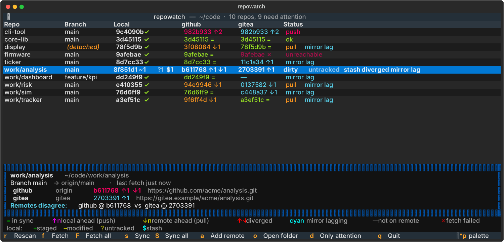

# repowatch

[](https://github.com/markgwharry/repowatch/actions/workflows/ci.yml)
[](https://pypi.org/project/repowatch/)
[](https://pypi.org/project/repowatch/)
[](LICENSE)

**Every git repo under a folder, compared across all of its remotes.**

Point repowatch at your code folder. It finds every repo, then shows one row per repo with a column per remote, so you can see at a glance where each copy stands: local, GitHub, a self-hosted Gitea, a backup.



It's built for people who keep the same code in more than one place, for example GitHub plus a work or home Gitea, or one machine at work and another at home. It answers three questions:

1. **Where does everything stand?** A matrix of every repo against every remote.
2. **Can it level them for me, safely?** `sync` fast-forwards your secondary remote and your local checkout to match the primary, in both directions. It never force-pushes or merges.
3. **What's all this branch clutter?** `prune` deletes branches whose work is already in `main`, including squash-merged ones, and explains every branch it keeps.

## Install

Requires Python 3.11+ and `git` on your PATH.

```bash
pipx install repowatch        # or: uv tool install repowatch
```

From source:

```bash
git clone https://github.com/markgwharry/repowatch && cd repowatch
pipx install .
```

> On Windows, use Windows Terminal, which is the default on Windows 11. The legacy console mangles the arrows. In Git Bash, write paths with forward slashes (`./repowatch`), because backslashes get eaten.

## Quick start

```bash
repowatch ~/code                     # interactive matrix
repowatch ~/code --fetch             # fetch every remote first
repowatch status ~/code              # print the matrix once
repowatch status ~/code --json       # machine-readable, for scripts and dashboards
repowatch init                       # write a commented config file
```

Set `root` in the config and plain `repowatch` opens your code folder.

## Reading the matrix

```
Repo             Branch  Local            github         gitea        Status
core-lib         main    965f254 ✓        965f254 =      965f254 =    ok
cli-tool         main    e5c17be ✓        f4a93cd ↑2     f4a93cd ↑2   push
ticker           main    5cd32d9 ✓        5cd32d9 =      e88d620 ↑1   mirror lag
work/tracker     main    577c22d ✓        5296d38 ↓1     577c22d =    pull mirror lag
work/analysis    main    fe0af99 ~1 ?1 $1 883a7b7 ↑1 ↓1  c458ab1 ↑1   dirty untracked stash diverged
```

Each remote cell shows that remote's tip of your current branch, and how your local HEAD compares with it:

| Symbol | Meaning |
|---|---|
| `=` | Same commit |
| `↑n` | Local has n commits the remote doesn't (push) |
| `↓n` | Remote has n commits local doesn't (pull) |
| `↑n ↓m` | Diverged |
| `—` | Branch doesn't exist on that remote |
| `✗` | Last fetch failed (offline, VPN down, auth) |
| cyan | A mirror remote is lagging. Expected; `sync` deals with it |

**Local** shows HEAD plus `+` staged, `~` modified, `?` untracked, `!` conflicts and `$` stashes, or `✓` when clean.

**Columns are labelled by host, not remote name.** `origin → github.com` and `upstream → github.com` both appear under `github`. Map your own hosts in the config.

### TUI keys

| Key | Action |
|---|---|
| `r` | Rescan (local only, fast) |
| `f` / `F` | Fetch the selected repo / all repos |
| `s` / `S` | Sync the selected repo / all repos: shows the plan first, `y` applies it |
| `a` | Add a remote (pre-filled from a template) |
| `o` | Open the folder |
| `d` | Show only repos that need attention |
| `q` | Quit |

## Sync

Keeps a **secondary** remote (e.g. Gitea) and your local checkout level with a **primary** remote (e.g. GitHub).

```bash
repowatch sync                      # dry run: the plan, nothing changed
repowatch sync --apply
repowatch sync --apply --repo my-service --repo docs
```

Everything is **fast-forward only**:

| Situation | What sync does |
|---|---|
| Primary ahead of secondary | Pushes primary's tip to secondary |
| Branch only on primary | Creates it on secondary |
| Secondary ahead of primary | Pushes secondary's tip to primary, so work done on the secondary flows up |
| Primary and secondary diverged | Flags it and touches nothing |
| Branch only on secondary | Flags it: could be new there, or deleted on primary |
| Local checkout behind and clean | Fast-forwards it |
| Local dirty, detached or diverged | Leaves it alone and flags it |
| Local has unpushed commits | Flags it. Pushing your own work stays your decision |

By default only `main`/`master` are synced and `dependabot/*` is skipped. Change `sync_branches` and `sync_exclude` (glob lists) in the config.

A protected branch on the primary rejects a secondary-ahead push. That's reported as a failed step and nothing else is affected. Unattended runs over SSH need a key without a passphrase, or a running agent; otherwise that remote shows as unreachable and is skipped.

### Run sync on a schedule

```bash
repowatch schedule              # hourly via Windows Task Scheduler (silent, via pythonw)
repowatch schedule --every 30
repowatch schedule --remove
```

Output goes to `sync.log` in the config folder and rotates at 1 MB. On macOS and Linux, `schedule` prints a crontab line for you to add.

## Prune

Deletes stale branches on the primary remote.

```bash
repowatch prune                          # dry run: what goes, and why the rest stay
repowatch prune --apply
repowatch prune --include-unmerged 180   # also abandoned branches, >180 days old, with no open PR
repowatch prune -v                       # also list merged branches it keeps
```

| Kind | Meaning | Default |
|---|---|---|
| **merged** | Tip already in the default branch (merge, fast-forward or rebase) | Deleted |
| **squash-merged** | Its combined change is already in the default branch as one commit | Deleted |
| **unmerged** | Has commits the default branch doesn't | Kept and listed |

It never deletes the default branch, anything matching `prune_keep` (default `main`, `master`, `develop`, `release/*`), anything younger than `prune_min_age_days` (default 7), or the branch you have checked out. Unmerged branches are only deleted with `--include-unmerged`, and only after the GitHub CLI (`gh`) confirms they have no open PR. Without `gh`, they're never touched. Deletions are verified against the remote afterwards.

To stop branches piling up again: `gh repo edit OWNER/REPO --delete-branch-on-merge`.

## Configuration

`repowatch init` writes a commented file to:

- Windows: `%APPDATA%\repowatch\config.toml`
- macOS / Linux: `~/.config/repowatch/config.toml`, or `$XDG_CONFIG_HOME/repowatch/config.toml`

```toml
root = "~/code"
depth = 3                            # folder levels to search
refresh_seconds = 30                 # TUI local auto-refresh; 0 = off
fetch_timeout = 25                   # seconds, per remote
column_order = ["github", "gitea"]
primary_labels = ["github"]          # sync's source of truth; prune's target
mirror_labels = ["gitea"]            # kept level by sync; lag shown as "mirror lag"
sync_branches = ["main", "master"]
sync_exclude = ["dependabot/*"]
prune_keep = ["main", "master", "develop", "release/*"]
prune_min_age_days = 7

[hosts]                              # host -> column label (exact match, then substring)
"git.example.internal" = "gitea"
"192.168.1.20" = "gitea"

[remote_templates]                   # pre-fills the TUI's add-remote dialog
gitea = "https://git.example.internal/{owner}/{repo}.git"
```

Use `repowatch --config other.toml …` to point at a different file.

## How it behaves

- **Remote columns are only as fresh as your last fetch.** `r` and the auto-refresh are local-only; `f`, `F`, `--fetch`, `sync` and `prune` go to the network.
- **It never prompts.** Terminal prompts, credential-manager pop-ups and interactive SSH are disabled. A remote that needs input shows `✗` and the reason, rather than hanging. Cached credentials (credential managers, keychain, ssh-agent) work normally.
- **Each remote is fetched separately, with a timeout**, so an unreachable Gitea doesn't hold up GitHub.
- **Discovery stops at the first `.git`.** It doesn't descend into repos, and it skips `node_modules`, `.venv`, `build` and similar.
- **Don't keep repos in a cloud-synced folder** (OneDrive, Dropbox, iCloud). Sync clients lock and duplicate files inside `.git`. Your remotes are the backup.

## Contributing

Issues and PRs are welcome. See [CONTRIBUTING.md](CONTRIBUTING.md). The test suite builds throwaway repos with GitHub- and Gitea-style remotes for every state repowatch distinguishes, and runs on Windows, macOS and Linux.

## Licence

[MIT](LICENSE)
